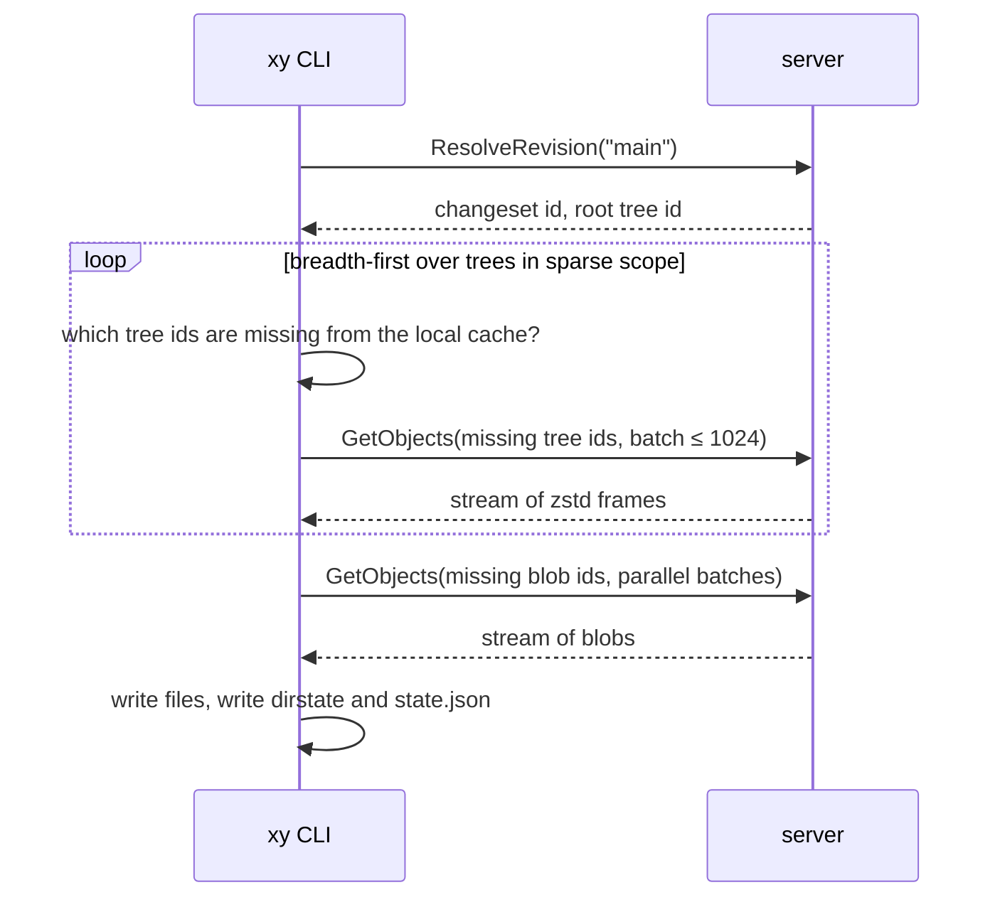
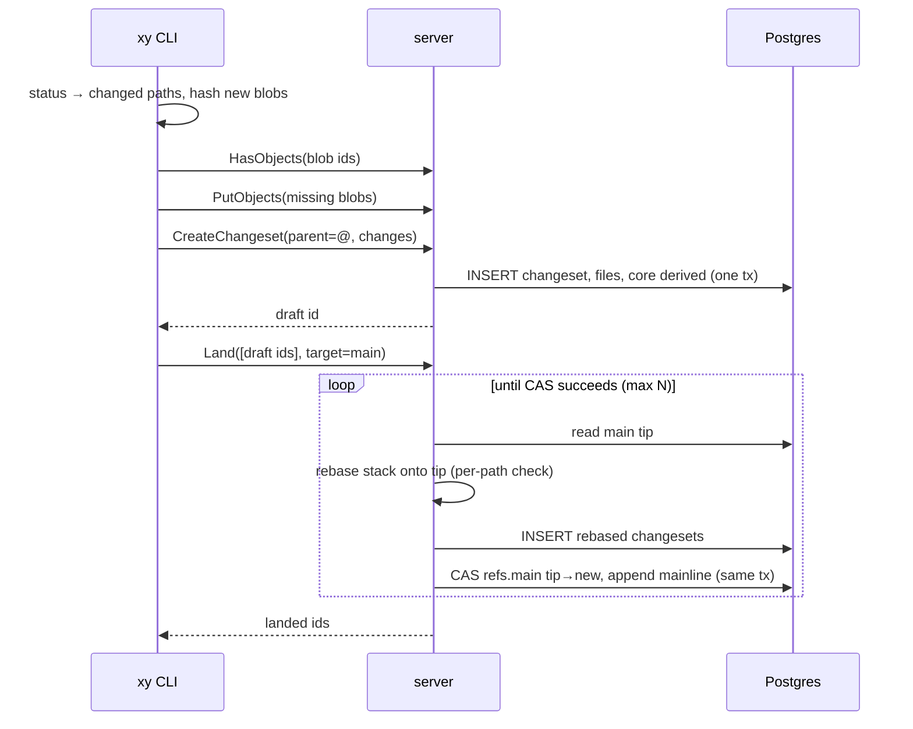

# 02 — Architecture

## Components

```mermaid
flowchart LR
  subgraph Client machine
    CLI[xy CLI] -->|gRPC| D[(xylemd daemon\nnode object cache)\npost-MVP]
  end
  CLI -->|gRPC: Repo, Write, Object| S
  D -->|ObjectService| C[xylemd cache\nregional, post-MVP]
  C -->|ObjectService| S[xylemd server]
  S --> PG[(Postgres\nmetadata, refs,\nderived indexes)]
  S --> OS[(Object store\nfs or S3/MinIO\nblobs, trees,\nlarge derived values)]
  IMP[xylemd import] --> PG
  IMP --> OS
  IMP -->|reads| GIT[(git repo)]
  JOBS[CI / tools / agents] -->|gRPC, no checkout| S
```

| Component | Binary | Role | Milestone |
|---|---|---|---|
| Server | `xylemd server` | Authoritative. Implements `RepoService`, `WriteService` and `ObjectService`. Stateless apart from caches, so it scales horizontally. | M2–M6 |
| Importer | `xylemd import` | Reads a git repo and writes changesets and objects. Resumable and incremental. | M3 |
| Admin tools | `xylemd migrate`, `xylemd admin init-repo\|set-ref`, `xylemd verify`, `xylemd verify-import`, `xylemd parity` | Schema migrations, repo and ref administration, integrity checks, import verification, git parity checks. | M2–M4 |
| CLI | `xy` | Workspace management, checkout, status, commit, land, history queries. | M5–M6 |
| Cache | `xylemd cache` | Regional object cache with the same `ObjectService` API, LRU in memory plus disk. | M8 |
| Daemon | `xylemd daemon` | Per-node shared object store over a Unix socket, same `ObjectService` API. | M8 |

**Key invariant:** server, cache and daemon all implement the identical `ObjectService`. The client only knows an address. Tiering is strict (daemon → cache → server) to isolate failure domains.

## Request flows

### Clone (sparse)



### Commit and land



## Code layout

```
xylem/
├── CLAUDE.md                  # agent instructions
├── README.md
├── Makefile
├── go.mod                     # module github.com/delefrati/xylem
├── buf.yaml / buf.gen.yaml
├── proto/xylem/v1/           # *.proto (source of truth for the API)
├── gen/xylem/v1/             # generated Go code (committed)
├── cmd/
│   ├── xy/                   # client CLI (cobra)
│   └── xylemd/               # server | cache | daemon | import | migrate | parity | verify
├── internal/
│   ├── hash/                  # ObjectID (BLAKE3-256), hex, prefix parsing
│   ├── paths/                 # path and name validation, split/join, ordering, IsUnder
│   ├── canon/                 # canonical primitive encodings (minimal varints, bytes, ids) for tree and changeset bodies
│   ├── object/                # blob and tree canonical encoding, zstd framing
│   ├── changeset/             # changeset model, canonical encoding, validation
│   ├── store/                 # ObjectStore interface + fs, s3 and memory implementations
│   ├── meta/                  # Postgres access layer (pgx), migrations runner
│   ├── derived/               # framework + kinds: core (roottree, graph), mainline, pathlog, blame
│   ├── treeops/               # tree lookup, incremental tree rewrite, tree diff
│   ├── diff/                  # Myers line diff, hunks
│   ├── merge/                 # per-path rebase logic, diff3 (M7)
│   ├── revision/              # revision syntax parser and resolver
│   ├── repo/                  # domain layer: CreateChangeset, RebaseStack, Land, UpdateRef, queries
│   │                          #   (composes meta + store + treeops + derived; used by server AND importer)
│   ├── server/                # thin gRPC adapters over internal/repo, interceptors
│   ├── client/                # workspace, dirstate, fetcher, checkout, status
│   ├── gitsource/             # git shell-out reader (rev-list, diff-tree, cat-file --batch)
│   ├── importer/              # git → Xylem import pipeline
│   ├── parity/                # git parity checks (library used by xylemd parity and tests)
│   ├── cache/                 # tiered object cache (M8)
│   └── testutil/              # DB and store helpers, fixture builders
├── migrations/                # 0001_init.sql …  (embedded via embed.FS)
├── scripts/                   # make-fixture-repo.sh, fetch-external-fixtures.sh, genrepo/ (Go)
├── test/
│   ├── e2e/                   # CLI end-to-end tests (-tags e2e)
│   └── bench/                 # tier and land benchmarks (M8, M9)
├── deploy/docker-compose.yml  # postgres + minio
├── testdata/                  # golden encodings; external/ is gitignored
└── docs/
```

Rules:
- Everything lives under `internal/`. Packages don't import `server` or `client` except from `cmd/`.
- `store`, `meta` and `derived` expose interfaces consumed by `repo`. `server` and `importer` depend on `repo`, never on `meta` directly. `cmd/xylemd` wires the concrete implementations.
- Pure logic (`object`, `changeset`, `treeops`, `diff`, `merge`, `derived` computations) has no I/O beyond interfaces, so it is unit-testable without Docker.

## Tech stack

| Concern | Choice | Notes |
|---|---|---|
| Language | Go (latest stable) | ADR-001 |
| RPC | gRPC + Protobuf, `buf` for lint and codegen | `google.golang.org/grpc`, `google.golang.org/protobuf` |
| Metadata | PostgreSQL 17 via `github.com/jackc/pgx/v5` | ADR-002 |
| Migrations | Plain SQL files embedded and run by `xylemd migrate`, tracked in a `schema_migrations` table | Small enough to hand-roll; no external tool |
| Object store | Interface with `fs`, `s3` (`github.com/minio/minio-go/v7`) and `mem` implementations | ADR-003 |
| Hashing | BLAKE3-256 via `github.com/zeebo/blake3` | ADR-004 |
| Compression | zstd via `github.com/klauspost/compress/zstd` | ADR-005 |
| CLI | `github.com/spf13/cobra` | |
| Config | Flags + env vars (server); TOML via `github.com/BurntSushi/toml` (workspace) | |
| Logging | `log/slog` (JSON in server, text in CLI) | |
| Metrics | `github.com/prometheus/client_golang` on `:7401/metrics` | |
| In-memory LRU | `github.com/hashicorp/golang-lru/v2` | |
| Duplicate suppression, errgroup | `golang.org/x/sync` (`singleflight`, `errgroup`) | |
| gitignore | `github.com/go-git/go-git/v5/plumbing/format/gitignore` (matcher only) | ADR-016 |
| Tests | stdlib `testing`, `github.com/google/go-cmp`, Go fuzzing | No assertion framework needed |

Adding any other dependency requires a line in `12-decisions.md`.

## Ports and addresses

| Port | Use |
|---|---|
| 7400 | gRPC (server; cache in M8) |
| 7401 | HTTP: `/healthz`, `/readyz`, `/metrics` |
| `$XDG_RUNTIME_DIR/xylem/daemon.sock` | daemon gRPC over a Unix socket (M8) |

## Scalability model (why this scales later)

- **Changeset inserts** are append-only rows keyed by content hash. Inserting the same changeset twice is idempotent (`ON CONFLICT DO NOTHING`). There is no global lock.
- **Refs** are touched only by land. Each land is one compare-and-swap on one row.
- **Objects** are immutable, so every tier can cache them indefinitely, keyed by id.
- **Derived data** is immutable per (kind, version, changeset, key), so it is cacheable indefinitely as well.
- **Servers** hold only caches, so you add instances behind a load balancer.
- The only hot row is `refs(main)`. Land throughput is bounded by CAS retries; see `07-write-path.md` for the batching mitigation.
