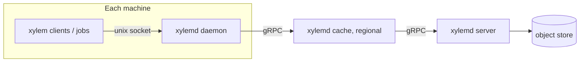

# 09 — Fetch protocol and caching tiers

## Fetch protocol

Git's negotiation tells the server what the client *has* and the server computes a packfile. Xylem inverts this: the client asks only for specific objects it **wants**, by id. Consequences:

- Every request is for immutable data, so **any cache can answer it**.
- No server-side computation of "missing objects" and no delta compression.
- Resumable by construction: re-request only what's still missing.
- Sparse and partial checkouts need no special support. The client just doesn't ask for trees outside its scope.

### Client algorithm

```
level := [root_tree]
while level not empty:
    missing := local.Missing(level)
    for batch in chunks(missing, 1024):            // up to 8 concurrent GetObjects streams
        for obj in GetObjects(batch):
            verify(obj); local.Put(obj)
    next := []
    for t in level: for e in decode(t).entries:
        if e.mode == TREE and inScope(path(e)): next.append(e.id)
        elif e.mode != TREE and inScope(path(e)): blobs.append(e.id)
    level = next
fetch(local.Missing(blobs)) the same way
```

The number of round trips equals tree depth plus blob batches, and batching keeps it low. A future optimization is a `GetTreeRecursive(root, scope, depth)` RPC so a server can push several levels at once. It's not in the MVP.

### Server side of `GetObjects`

- Read from the object store in parallel (bounded worker pool, default 32).
- Stream responses as soon as objects arrive (no ordering guarantee), packing messages up to about 1 MiB; an object larger than that is sent alone (max message size is 80 MiB, see 05 §Conventions).
- An in-memory LRU of hot objects (default 1 GiB) sits in front of the store.
- Send ids not found in the final message's `missing`.

## Caching tiers (M8)



All three implement `ObjectService.GetObjects` and `HasObjects` identically. A tier is just an `ObjectService` with a local cache plus one upstream `ObjectService` client.

```go
// internal/cache
type Tier struct {
    local    LocalCache            // memory LRU + optional disk LRU (stored frames, same key layout as fs store)
    upstream xylemv1.ObjectServiceClient
    sf       singleflight.Group    // collapse concurrent misses for the same id
}
```

- **On a miss:** batch misses from concurrent requests over a short window (≤ 2 ms), fetch them from upstream, store them, then serve.
- **Verification:** each tier verifies hashes of objects received from upstream before caching (cheap with BLAKE3).
- **Strict tiering:** a daemon may only point at a cache, and a cache only at a server. This is enforced by config validation (`--upstream-kind`). Tiers expose `xylem_cache_hits_total`, `xylem_cache_misses_total`, `xylem_cache_bytes` and `xylem_upstream_inflight`.
- **Protection:** each tier limits in-flight upstream requests (default 256) and fails fast with `ResourceExhausted` beyond a queue limit, so a cold regional cache can't stampede the servers.
- **`PutObjects`:** daemon and cache tiers forward it to upstream unchanged and also store locally (write-through).
- **Metadata RPCs** (`RepoService`, `WriteService`) aren't cached by tiers in the MVP. The daemon proxies them transparently, so clients need only one address.

### Daemon specifics

- Listens on `$XDG_RUNTIME_DIR/xylem/daemon.sock` (mode 0700 directory).
- Disk cache under `$XDG_CACHE_HOME/xylem/objects`, size-capped (default 20 GiB), LRU by access time, tracked in an in-memory index rebuilt at start.
- Optional warm start from a **seed**: a tarball of objects for a recent `main` root tree in a given sparse scope (`xylemd seed build|load`). Post-M8.

## Local client cache vs daemon

Without a daemon, each workspace keeps its own `.xylem/objects` LRU. With a daemon configured (`server = "unix://…"`), the client can set `cache_max_bytes = 0` and rely on the daemon, so many workspaces on one machine share objects.

## Benchmarks to record (M8)

- Cold sparse clone time and bytes over the network: direct-to-server vs via a warm cache.
- Cache hit rate under a synthetic CI workload (100 parallel clones of recent `main` revisions).
- Server CPU per GiB served, compared to `git upload-pack` for the same tree (informational).
